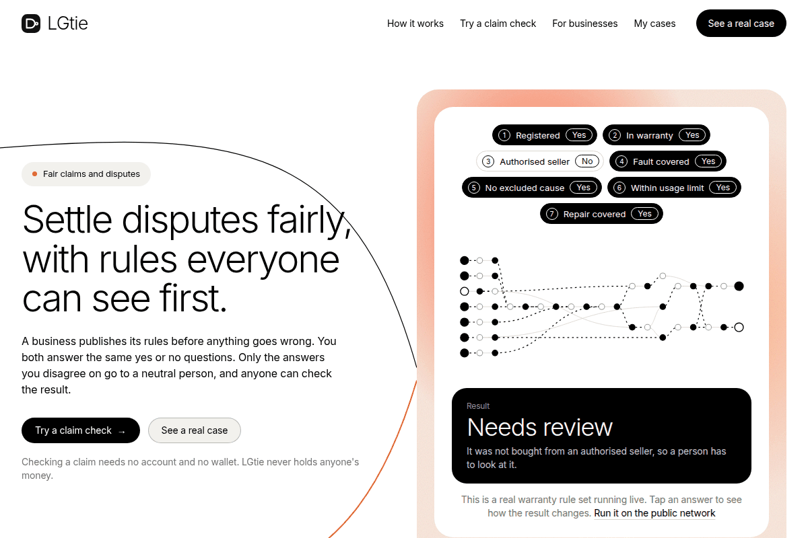
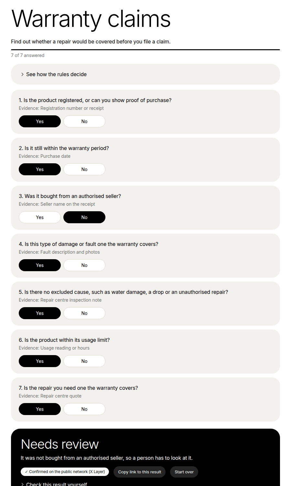
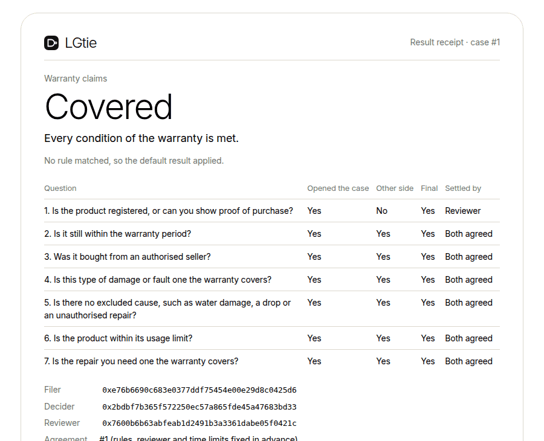
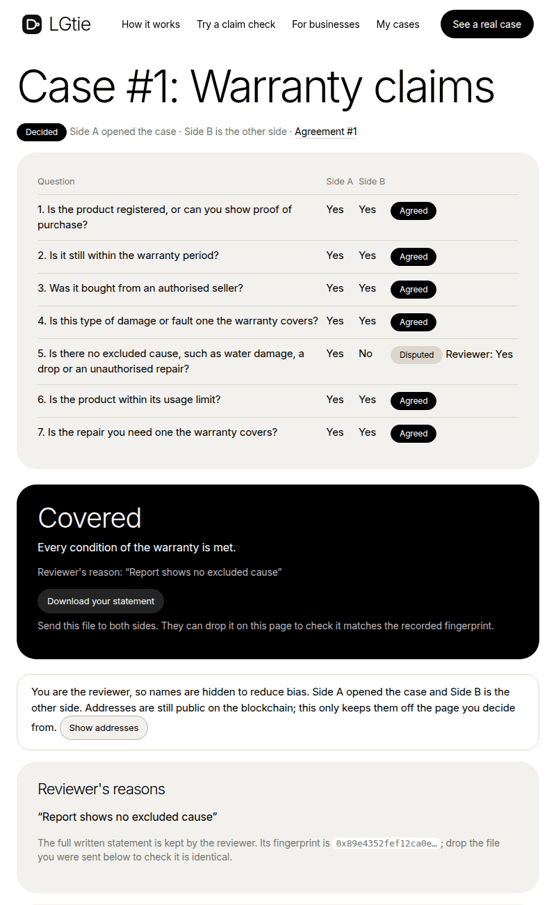
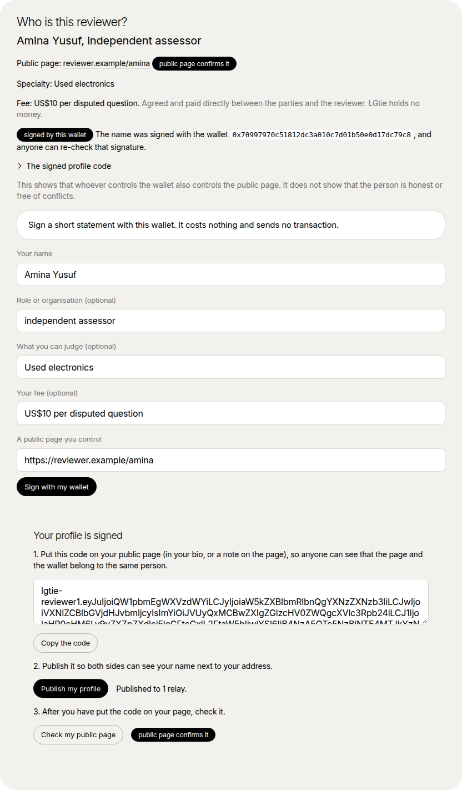
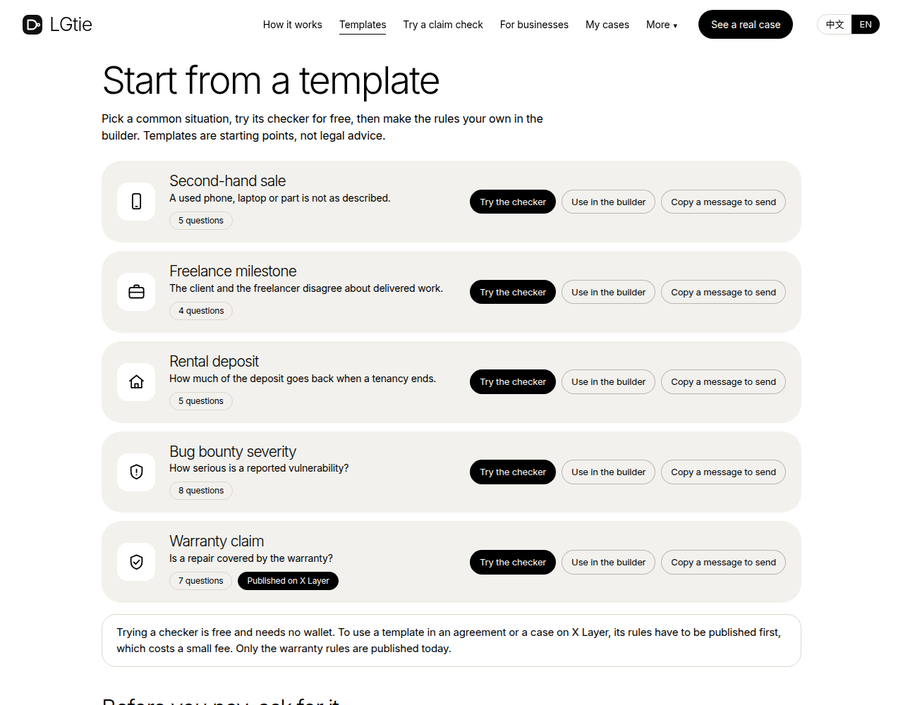
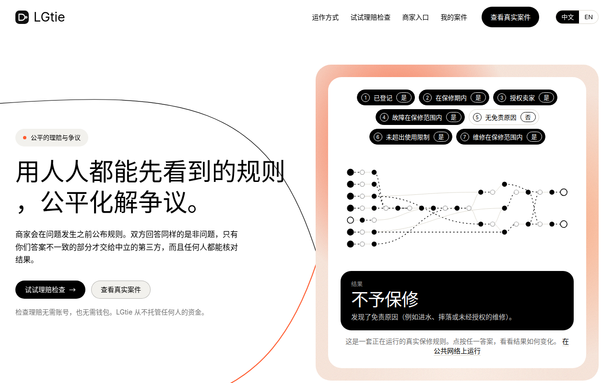
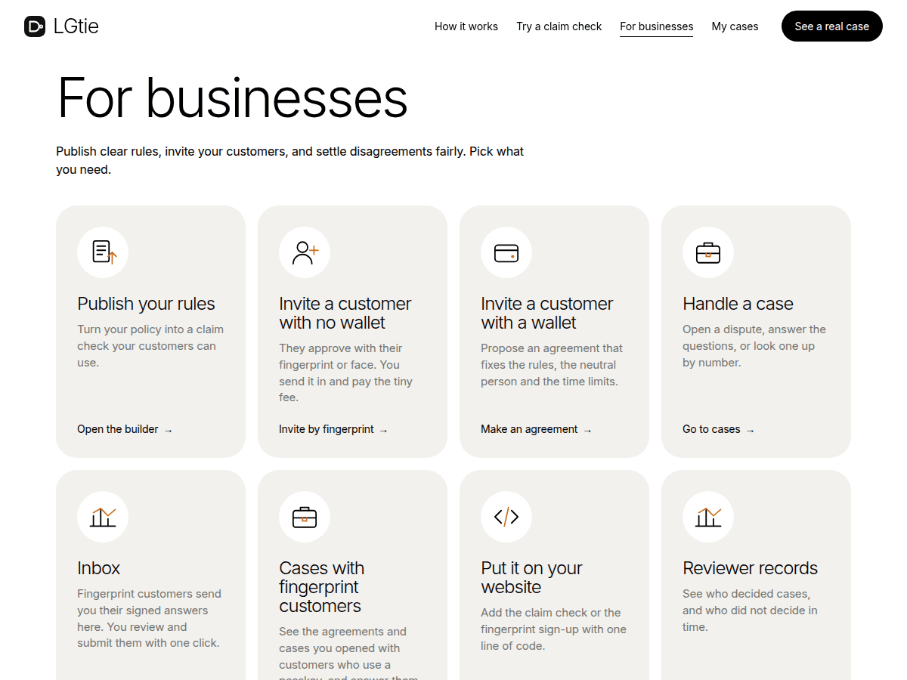
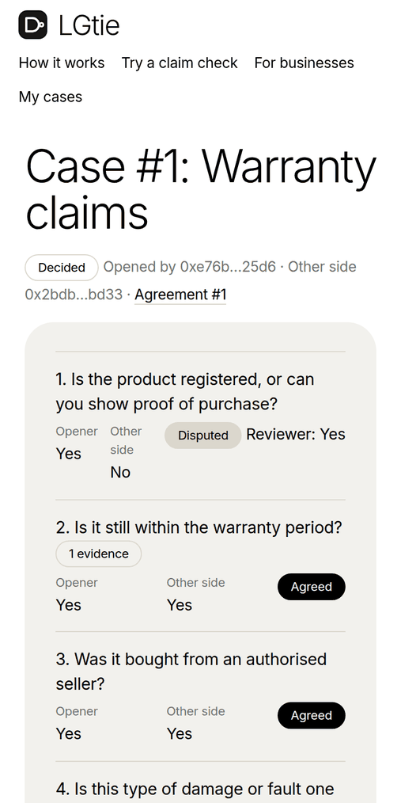

# LGtie

**Settle disputes fairly, with rules everyone can see first.**

> **Start here:** **[Open the live app](https://lgtie.vercel.app/)** · **[See a real case settled on X Layer](https://lgtie.vercel.app/#case/1)** · [Try the fictional support page](https://lgtie.vercel.app/embed-demo.html)

LGtie is a prototype for the **X Layer TapeOut Accelerate** hackathon. It is early software: the contracts are unaudited and it has no customers yet.

## The problem

When a claim or a report is disputed (a warranty repair, a refund, a bug's severity), the rules usually live inside one side's own process. Both sides argue about the whole outcome, nobody can show afterwards that the rules were applied the same way every time, and the person who decides is often one of the parties.

## What LGtie does

1. A business **publishes its rules in advance** as simple yes or no questions. Once published they cannot be changed quietly.
2. Both sides **agree up front** on those rules, on a neutral person who would decide any disagreement (a reviewer who can sign a **named, checkable identity** instead of being just a wallet address), and on the time limits.
3. If a dispute comes, **both sides answer the same questions**. Where the answers match, it is settled.
4. **Only the questions they disagree on** go to the neutral person. Nothing else.
5. The published rules turn the final answers into a **result and a reason**, and **anyone can re-run it for free** and get the same result.

A customer does not need a crypto wallet: they can approve with the fingerprint or face scan that unlocks their phone.

LGtie never holds anyone's money. It records decisions and checks that rules were applied consistently. It cannot tell whether someone is telling the truth; a neutral person settles the facts the two sides disagree on.

## Why people would use it

People reach for LGtie when arguing costs more than agreeing, or when trust is thin before a deal even starts.

- **Buyers, freelancers and bug hunters.** Before you pay, ask: "Will you accept an LGtie agreement?" If the other side will not lock in the refund or payment rules first, you have learned something. If they will, you both know what happens if it goes wrong, and only the answers you disagree on are ever argued about.
- **Honest sellers and small businesses.** Showing the rules up front reduces arguments, and the receipt of a decided case (`#receipt/<id>`) shows which rules both sides agreed and who settled each question. That is useful supporting evidence if a payment company or a platform asks. They decide what they accept, so it is not a guarantee of winning a chargeback.

The [templates](https://lgtie.vercel.app/#templates) make the first step quick: pick second-hand sale, freelance milestone, rental deposit, bug bounty or warranty, try its checker for free, and copy a ready-made message to send to the other side.

## Try it (no wallet needed)

| What | Where |
| --- | --- |
| Check a warranty claim and see the result and the reason | https://lgtie.vercel.app/#check/warranty |
| Read a real case that was settled on X Layer (played by the project's builder, so a demonstration, not a customer) | https://lgtie.vercel.app/#case/1 |
| Its one-page receipt, which you can print or save as a PDF | https://lgtie.vercel.app/#receipt/1 |
| A fictional support page with the fingerprint (passkey) flow embedded | https://lgtie.vercel.app/embed-demo.html |
| How it works, as a short animated story | https://lgtie.vercel.app/#about |
| Start from a ready-made template (second-hand sale, freelance milestone, rental deposit, bug bounty, warranty) | https://lgtie.vercel.app/#templates |
| A reviewer's page: who they are (their signed name and public page), their record, and, if the address is yours, how to set up your own profile | `https://lgtie.vercel.app/#reviewer/<wallet address>` |
| The same app in English (it opens in Chinese; use the 中文 / EN button in the header) | https://lgtie.vercel.app/?lang=en |
| Everything a business can do, including its inbox for customers' signed actions and the passkey cases | https://lgtie.vercel.app/#for-business |

## Screenshots

Taken from the live site, except the four marked "test environment", which come from the automated end-to-end test (a fork of X Layer, test wallets and a virtual passkey, so they show how the pages behave, not real customers).

**Check a claim, build the rules**

<p></p>
<p><sub>The home page runs the real published warranty circuit: tap an answer and the result and reason change.</sub></p>

<table><tr>
<td width="50%"><br><sub>The claim checker. The result is confirmed on X Layer.</sub></td>
<td width="50%"><br><sub>The guided builder: questions, a click-to-cycle rule grid, a test, then publish.</sub></td>
</tr></table>

**A real case on X Layer** (played by the project's builder, so a demonstration, not a customer)

<table><tr>
<td width="50%"><br><sub>Six answers matched. One differed, so only that question went to the reviewer.</sub></td>
<td width="50%"><br><sub>The one-page receipt, which you can print or save as a PDF.</sub></td>
</tr></table>

**No wallet for the customer** (test environment)

<table><tr>
<td width="50%"><br><sub>A customer adds evidence on their own device and signs it with their fingerprint. Nothing is uploaded.</sub></td>
<td width="50%"><br><sub>The business's inbox: the customer's signed action is waiting, and one click submits it.</sub></td>
</tr></table>

**The reviewer** (test environment)

<table><tr>
<td width="50%"><br><sub>A reviewer must give written reasons and a no-conflict declaration before deciding.</sub></td>
<td width="50%"><br><sub>The decided case shows the reviewer's reason. Sides are labelled A and B while the reviewer decides.</sub></td>
</tr></table>

**Named reviewers** (test environment, with a fictional reviewer and a test key)

<p></p>
<p><sub>A reviewer signs their name and a public page with their wallet. The page checks the signature in the browser and the public page, and the name then appears next to the address on the agreement, the case and the receipt.</sub></p>

**Templates**

<p></p>
<p><sub>Pick a common situation, try its checker for free, open it in the builder, or copy a message to send to the other side.</sub></p>

**Chinese and English**

<p></p>
<p><sub>The app opens in Chinese. The 中文 / EN button in the header switches language and remembers the choice.</sub></p>

**For businesses, and on a phone**

<table><tr>
<td width="60%"><br><sub>Everything a business can do, in one place.</sub></td>
<td width="40%"><br><sub>The pages are laid out for phones.</sub></td>
</tr></table>

<p></p>
<p><sub>"How it works" tells the story in six animated steps.</sub></p>

## How it works

```
  1. The business publishes its rules          (yes/no questions, stored on X Layer)
                    |
                    v
  2. Both sides agree in advance on            the rules, a neutral person, the time limits
                    |
                    v
  3. Both sides answer the same questions ---- answers match --->  settled, no argument
                    |
              answers differ
                    v
  4. The neutral person answers ONLY the questions they differ on
                    |
                    v
  5. The published rules give the result and the reason
                    |
                    v
     Anyone can re-run it, for free, and get the same result
```

- **Rules.** A business writes questions and rules in a guided builder. The page turns them into a small logic circuit and proves, in the browser, that the circuit gives the same answer as the rules in **every possible situation**.
- **Publishing.** One click records the circuit on the TapeOut processor and registers it, with a fingerprint of the rules text, in a public registry. An entry never changes; a new version is a new entry.
- **Agreements (optional).** Two parties accept one published rule set, a neutral reviewer and the time limits. After that none of it can be changed or withdrawn.
- **Cases.** Each side answers before a deadline. Equal answers finish the case at once. Different answers go to the reviewer both sides accepted, who answers only the disputed questions. A case nobody finishes in time ends as **no decision**; nobody wins by default.
- **Result and replay.** The processor computes the result. Anyone can recompute it, and other contracts can read the decision with `verdict(id)` (see `docs/VERDICT.md`).
- **Reviewer accountability.** A reviewer has to write reasons and tick a conflict-of-interest declaration before deciding. The page saves the written statement as a file for the reviewer to send to both sides and records only its fingerprint on X Layer, with a one-line public reason that shows on the case page and receipt. While the reviewer decides, the page shows "Side A" and "Side B" instead of addresses (addresses are still public on-chain, so this reduces bias but is not true blind review).
- **Templates.** One-click rules for common arguments (`site/templates.js`), each in English and Chinese: a second-hand sale, a freelance milestone, a rental deposit, bug-bounty severity and the warranty rules. Each gets a free checker, opens in the builder to be changed, and has a message you can copy to send to the other side. Nothing is published on X Layer until you publish it, so only the warranty rules are on-chain today. They are starting points, not legal advice.
- **Named reviewers.** A reviewer used to be only a wallet address. A reviewer can now sign a short profile with their wallet (name, role, optionally what they can judge and what they charge, and a public page they control), put the same signed code on that page, and publish it to public relays. The agreement, case and receipt pages then show the name next to the address, with a plain "address only" warning when there is none. The signature is checked in the browser (no server, no contract change), and an agreement can include the reviewer's identity in the terms both sides fingerprint. It proves that the wallet and the public page share an owner. It does not prove the person is honest, qualified or free of conflicts. The specialty and fee are what the reviewer says; any fee is agreed and paid directly between the parties and the reviewer, because LGtie holds no money. Details: [docs/SECURITY.md](docs/SECURITY.md#named-reviewers).
- **A clause for your written contract.** The templates page (and every agreement page) can write a short clause for a contract: disagreements about the facts go through the published questions, only the differences go to a named neutral person, and the outcome is either binding on the parties as an expert determination of facts or advisory only. It never calls the result a court judgment or an arbitral award, leaves the right to go to court or to arbitration untouched, and warns that the record is public. It is a template, not legal advice: have a lawyer read it. Details and the questions to ask a lawyer: [docs/USING-WITH-CONTRACTS.md](docs/USING-WITH-CONTRACTS.md).
- **Two languages.** The app opens in Chinese and switches to English with the 中文 / EN button in the header (the choice is remembered on the device; `?lang=en` or `?lang=zh` in the address also sets it). Translation is a display layer (`site/lang.js` and the dictionary in `site/zh.js`): it never changes the app's logic, rule text, circuits or anything recorded on-chain, and text with no entry simply stays in English. What stays in English on purpose: rules a business types itself, the built-in rule examples shown inside the builder's fields, the AI-assistant request and the downloadable claim pack and statement files (formats other people and tools read), and the fictional Acme demo page.
- **Evidence.** Files are never uploaded. A party (including a customer with a passkey, who signs it) records a digital fingerprint of a file, or of a written explanation they download, plus a short note. A reviewer can drop the file they were sent into the case page, and the browser says whether it is identical to the recorded one. A fingerprint shows a file is unchanged, not that it is genuine.
- **Receipts.** Any decided case has a one-page receipt (`#receipt/<case id>`) with who answered what, who settled each question, and a live re-check of the rules.

### Customers without a wallet (passkeys)

A customer creates a **passkey** (the same thing that unlocks their phone) and gets a public claim code. The business registers it and proposes an agreement. The customer approves the agreement and their answers on their own device. Each approval covers the exact action, the case, a one-time number and a deadline, so it cannot be altered, replayed or moved. Anyone with a wallet, usually the business, submits it and pays the tiny network fee. X Layer verifies the passkey signature with its built-in P-256 check. The customer's own page first proves on-chain that the account is controlled by their passkey. Details and tests are in `docs/PASSKEYS.md`.

**The inbox.** A passkey can sign but cannot pay network fees, so someone with a wallet has to submit what the customer signed. After signing, the customer's page posts the signed action to a few public message relays (Nostr), addressed to the business's wallet address. The business opens `#inbox`, sees what is waiting, and submits it with one click. A relay cannot change a signed action (the contract rejects any change) and learns nothing that is not already public on-chain; it can drop a message, so a copy-link fallback is always shown. The business has to open the inbox; there are no notifications because there is no server. The same page lists cases waiting for the signed-in wallet's decision when that wallet is the neutral reviewer (found by reading the chain, not through the relays), and the agreement and case pages give the business a ready-made message to send the reviewer, with a link that opens the decision form directly. A reviewer still needs a wallet and pays the fee, and nothing reminds them unless the business runs the optional bridge below.

**The optional bridge.** `bridge/` holds a small Node script that a business can run itself (LGtie runs no server). It listens for the same relay messages, posts a notice to a webhook (Slack, Discord, Zapier, Make or any URL), can submit each signed action with a gas-only relayer key so nobody opens the inbox, and can tell a reviewer by webhook when a case is waiting, with a link that opens the decision form. It simulates every action first, only sends to the LGtie contracts and has a daily cap. See `bridge/README.md`.

### Writing rules

```
name: Warranty claims
about: One line shown to the person answering
question: Is it still within the warranty period? | Evidence to ask for (optional)
result: Not covered           (results are numbered in the order written)
result: Covered
rule: Q2=no -> Not covered : The reason shown        (top to bottom; the first rule that matches decides)
rule: Q1=yes & Q3=no -> Not covered : Join conditions with &
default: Covered : Shown when no rule matched
```

Two examples are built in: `warranty` (published) and `bounty` (bug-bounty severity, not yet published).

### Put it on your own website

```html
<div></div><script src="https://lgtie.vercel.app/embed.js" data-checker="warranty" async></script>
```

Add `data-flow="join"` to let customers create a passkey on your page (your page receives the claim code through `data-onclaim="yourFunction"`), or `data-flow="mine"` to show a customer their own cases. The embed only adds a frame and relays two checked messages. `site/embed-demo.html` is a complete example.

## What is live on X Layer (chain 196)

| Contract | Address |
| --- | --- |
| TapeOut processor (existing, reused) | `0x9e2849c04a513fe64db07521cbe52d078d905c0e` |
| Warranty rules | circuit #13: 7 questions, 39 logic gates, checked against the written rules on all 128 situations |
| `RuleSetRegistry` | `0x25E87D367316038a2d3B6A4fe3d58AA453D4c219` (rules #1 is "Warranty claims") |
| `AgreementRegistry` | `0xC3e61E38d977Be9e9B4649e5965892bF6f675180` |
| `TiebreakCaseV3` | `0xF6C636e1f08bdE711d1FDdc40eb23DEa7719Ec67` (wallet parties; used by the real case above) |
| `PasskeyRegistry` | `0xC3c0E2Fa6D8452A14063c01DC50159487E78522E` |
| `AgreementRegistryV2` | `0x802995325A576b69175DCE24e8D643553C9ba2ed` (the other party can be a passkey account) |
| `TiebreakCaseV4` | `0x178bB4ddC548F3456bD5AE2de7Abe67A8DCb02d0` (wallet or passkey parties; accepts only the official processor) |

The contract names keep the project's earlier name, Tiebreak. There is one real run on mainnet (agreement #1 and case #1), played by the project's builder; there is no real passkey case yet. `node tests/mainnet-verify.mjs` checks circuit #13 against the rules for all 128 situations, read-only.

## Run it yourself

```
cd site && python3 -m http.server 8090        # then open http://localhost:8090
node tests/rules.test.mjs                      # rule engine
node tests/pkcore.test.mjs                     # passkey encoding, checked against Foundry's cast
node tests/reviewer.test.mjs                   # reviewer statements and blind review
node tests/nostr.test.mjs                      # Nostr signatures, against the official test vectors
node tests/templates.test.mjs                  # the five templates, in both languages: they parse, the circuit equals the rules, every result is reachable, English and Chinese behave the same
node tests/reviewerid.test.mjs                 # named reviewers: wallet signatures (a real one made with cast), profile codes, the page check
cd contracts && forge test                     # 119 contract tests (some run on a fork of X Layer and need network access)
node tests/mainnet-verify.mjs                  # read-only check of circuit #13 on X Layer
```

Browser tests (checker, builder, embed, receipt, publishing, the full case flow, named reviewers, templates, the two languages, the passkey story including a cross-site frame, and a read-only smoke test of the live site) are in `tests/browser/`; see its README for what they need.

**Deploy.** The site is static: one page plus `embed.js` and `embed-demo.html`, in `dist/`. `node scripts/bundle.mjs` rebuilds it from `site/`. On Vercel, import the repository and keep the Framework Preset as **Other**; `vercel.json` already serves `dist/` with no build step. A passkey is tied to the site's exact address, so decide the final address before anyone creates real passkeys.

## Project layout

| Path | What is in it |
| --- | --- |
| `bridge/` | The optional self-hosted bridge: relay messages to a webhook, optional auto-submit, reviewer pings |
| `site/` | The web app, with no server: rule engine and compiler (`rules.js`), guided rule builder (`builder.js`), case, agreement, receipt and reviewer pages (`cases.js`, `reviewer.js`), named reviewers with signed profiles (`reviewerid.js`), rule templates and their page (`templates.js`), the Chinese and English languages (`lang.js` and the dictionary `zh.js`), passkey pages and inbox (`passkeys.js`, `nostr.js`, `pkcore.js`), one-click publishing (`publish.js`, `wallet.js`), animated graphics (`graphics.js`, `hero.js`), embed script (`embed.js`), addresses (`config.js`) |
| `contracts/` | Foundry project with the contracts above and their tests |
| `dist/` | The built site, a single self-contained page (about 300 KB including the embedded Inter typeface; no external assets) |
| `scripts/` | Deploy and publish scripts (`deploy-v3.sh`, `deploy-v4.sh`, `publish-rules.sh`, ...). Each has a read-only `preflight` mode and you run the spending steps with your own Foundry keystore |
| `tests/`, `test/` | Rule engine, passkey encoding, mainnet check and browser tests |
| `docs/` | `PASSKEYS.md` (passkey design and test log), `VERDICT.md` (reading a decision from another contract), `SECURITY.md` (a manual security review) |

## Honest limits

- **It does not check that answers are true.** The result follows the answers given. A reviewer decides disputed facts, and a reviewer can be wrong. LGtie shows the rules were applied consistently, nothing more.
- **It is not a court, an arbitration or legal advice.** The reviewer answers yes or no questions without a hearing, so the outcome is an expert-style determination of facts if the parties' contract says so, not an arbitral award. Nobody has reviewed the clause with a lawyer. See [docs/USING-WITH-CONTRACTS.md](docs/USING-WITH-CONTRACTS.md).
- **Everything recorded is public.** Answers, fingerprints of evidence, the reviewer's written reasons, wallet addresses and times are on a public blockchain and cannot be deleted. Do not use LGtie for matters that must stay confidential.
- **A neutral reviewer can still be biased.** Both sides accept the reviewer, but nothing stops them agreeing on a bad one, or on the same false answers. There is no staking, jury or penalty. Written reasons make a bad decision visible, they do not prevent it. A named reviewer is only as trustworthy as their public page: a reviewer profile proves who controls the wallet, not that the person is honest, and a relay can hide a profile (it cannot change one).
- **A case nobody finishes ends as "no decision".** That is safe, but the sides then have to open a new case.
- **The inbox depends on public relays, and actions go in order.** They are run by other people, may be slow or drop messages, and nothing tells the business to look; messages older than three days are not shown. The customer's page says when relays could not be reached, and the copy-link fallback still works.
- **Passkeys prove a device, not a person.** The business ties a passkey to a customer through its own login. If someone loses every device with their passkey, recovery is not built yet (a second device or a synced passkey is the fallback). The passkey flows are tested in Chrome with a virtual authenticator, and the whole flow was tried once by the builder on a real phone; Safari and Firefox are untested.
- **A normal smart contract could hold the same decision table.** What TapeOut adds is a rule published as data, so it cannot hold hidden state or an admin key, and anyone can re-run it for free.
- **No escrow, on purpose.** Another system can read a decision and pay out; see `docs/VERDICT.md`.
- **Early prototype.** The contracts are unaudited and hold no funds. There are no customers, no revenue and no validated prices; any pricing ideas are hypotheses.

## Roadmap and next steps

What comes after the hackathon, in rough order:

1. **Assisted passkey recovery.** The contract already lets an account add a second device; the pages for it, and a recovery path with a reviewer's countersignature and a delay, are not built.
2. **A first pilot with a real business**, to learn what it would pay for and which disputes matter. Today the pricing ideas in `docs/SUBMISSION.md` are guesses.
3. **Publish the templates people actually use.** Second-hand sale, freelance milestone, rental deposit and bug bounty already work as free checkers, but only the warranty rules are published on mainnet (publishing costs a small fee each). They are needed on-chain before they can be used in an agreement or a case.
4. **An independent security review** before any real customer relies on it.
5. **Hosted notifications and reminders.** A self-hosted bridge exists (see above). A hosted version for businesses that will not run anything themselves would end the no-server design, so it would be an add-on, not the core.
6. **A shared reviewer directory.** Named reviewers prove that a wallet and a public page share an owner, but there is no shared list of vetted reviewers or reviews of them. That would need an operator or on-chain attestations.
7. **Pay on a verdict (escrow).** A companion contract that releases funds when `verdict(id)` resolves would make a decision pay out by itself. It is deliberately not built: it would hold real money, needs an independent audit first, and LGtie's position is that it holds no funds. Another team's escrow can already read a decided verdict (check `isFinal` first, see `docs/VERDICT.md`).
8. **A copy hosted on TapeOut's DeWEB**, if the passkey and relay features work there.

