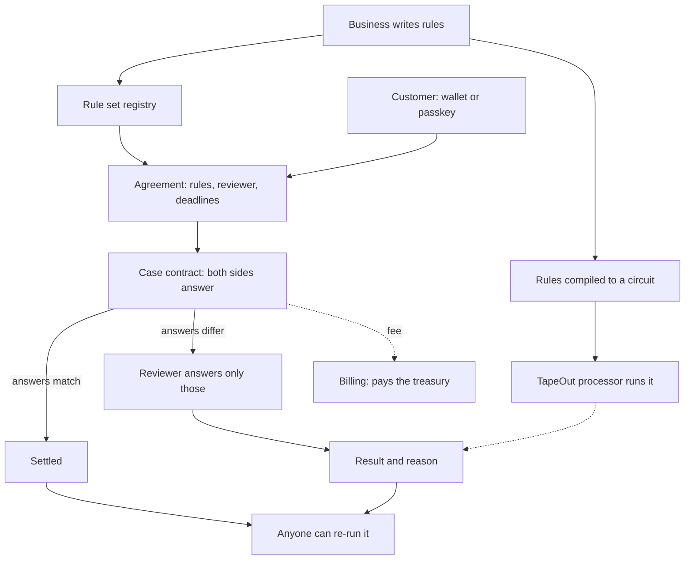
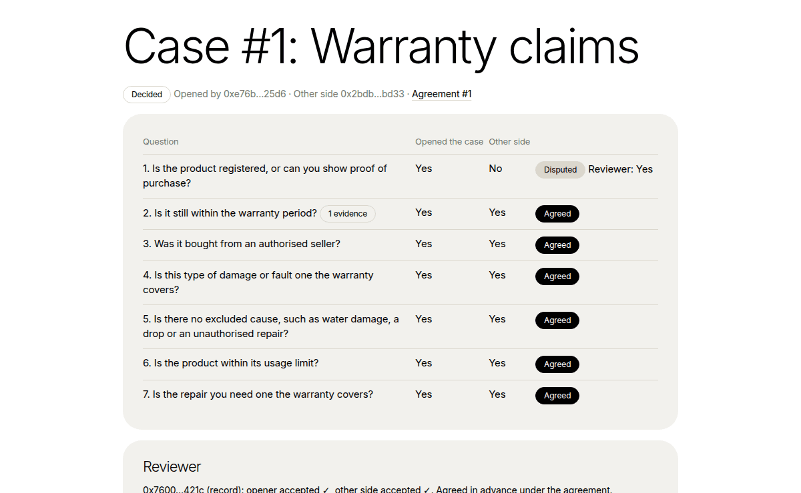

# LGtie

**Settle disputes fairly, with rules everyone can see first.**

> **[Open the live app](https://lgtie.vercel.app/)** · **[A real case settled on X Layer](https://lgtie.vercel.app/#case/1)** · [Fictional support page with the embedded checker](https://lgtie.vercel.app/embed-demo.html) · [Features in detail](docs/FEATURES.md)

Built for the **X Layer TapeOut Accelerate** hackathon. It is early software: the contracts are unaudited, it holds no funds and it has no customers yet.

## Pitch

LGtie is a **dispute layer for published rules**. A business publishes its rules as yes or no questions on X Layer, before anything goes wrong. If a dispute comes, both sides answer the same questions, and **only the questions they disagree on** go to a neutral person both agreed on. The published rules turn the final answers into a result and a reason that **anyone can re-run for free**. There is no server and no escrow, and a customer uses a **passkey** and does not need a wallet.

It is the step between "we disagree" and "we go to court": cheap, fast, and decided by rules nobody could change afterwards.

## Problem

When a claim or a report is disputed (a warranty repair, a refund, a bug's severity), the rules usually live inside one side's own process.

- Both sides argue about the **whole outcome**, not the one fact they actually disagree on.
- Nobody can show afterwards that the rules were **applied the same way every time**.
- The person who decides is often **one of the parties**.
- Courts and arbitration are slow and costly for small amounts, so most small disputes are settled by whoever has the most power.

## Solution

1. The business **publishes its rules in advance** as yes or no questions. Once published they cannot be changed quietly.
2. Both sides **agree up front** on those rules, on a neutral reviewer (who can sign a named, checkable identity) and on the time limits.
3. If a dispute comes, **both sides answer the same questions**. Where the answers match, it is settled.
4. **Only the disputed questions** go to the reviewer. Nothing else.
5. The published rules give a **result and a reason**. Anyone can recompute it and get the same result.

A customer uses a passkey and does not need a wallet. LGtie never holds anyone's money, and it cannot tell whether someone is telling the truth; the reviewer settles the facts the two sides disagree on.

<p></p>
<p><sub>The home page runs the real published warranty circuit: tap an answer and the result and the reason change.</sub></p>

## Who it's for

LGtie suits disputes that come down to a handful of yes or no facts and recur for the same business.

| Target | The dispute | Starting template |
| --- | --- | --- |
| **Online shops and marketplaces** | Returns, refunds, items not as described | Second-hand sale |
| **Electronics, appliance and repair businesses** | Warranty claims | Warranty claim (live on X Layer) |
| **Freelancers, agencies and their clients** | Is a milestone delivered and accepted, and what is owed | Freelance milestone |
| **Landlords and property managers** | Rental deposit deductions | Rental deposit |
| **Crypto protocols and bug-bounty programmes** | How severe is a reported vulnerability | Bug bounty severity |
| **Any business with its own recurring claims** | Rules of its own | Write your own in the builder |

The buyer is the business, which publishes the rules and subscribes. The customer, buyer or researcher on the other side joins with a passkey and pays nothing to take part.

## Architecture



- **A static site.** No server and no database: the web app, the rule compiler and the checks run in the browser (`site/`). The built site is one page in `dist/`.
- **Rules are data, not code.** A rule set compiles to a small circuit of NAND gates and is stored on the existing **TapeOut processor**, so it cannot hold hidden state or an admin key.
- **Contracts** (`contracts/`, Foundry): `RuleSetRegistry`, `AgreementRegistry` (and V2), `TiebreakCase` V3 to V6, `PasskeyRegistry`, `LGtieBilling`, `FactSpecRegistry`. `AgreementRegistryV3` lets a passkey account propose an agreement, not only accept one. `AgreementRegistryV4` adds agreement cards (a deal both passkeys sign off-chain, recorded only if needed) and `TiebreakCaseV7` lets the reviewer be agreed after a dispute starts. V4 accepts only the official processor and lets a party be a passkey account, using X Layer's built-in P-256 check.
- **No wallet for customers.** A passkey signs each action; any wallet (usually the business's) submits it and pays the small fee. Signed actions travel through public Nostr relays to the business's inbox.
- **Optional bridge** (`bridge/`): a script a business runs itself to forward those messages to Slack, Discord or any webhook.

The contract addresses and what is live are listed [below](#live-on-x-layer-chain-196).

<p></p>
<p><sub>A real case on X Layer (played by the project's builder, so a demonstration, not a customer). Six answers matched, one differed, so only that question went to the reviewer.</sub></p>

## What makes it different

- **Neither side is forced to accept the other's reviewer.** A reviewer is proposed in the agreement and takes effect only when both sides accept it, and it cannot be swapped afterwards. Before accepting, a person sees who the reviewer is, their signed identity and their own declaration of any relationship with the parties, with a plain warning if there is only a wallet address.
- **Fewer disputes by design.** A rule set can mark questions that need no human, such as "was the evidence attached in time?" or "does this on-chain value meet the agreed threshold?". The contract answers those itself, the sides cannot dispute them and a reviewer cannot change them. It decides only when something was recorded or what a chain says, never whether evidence is true. [Design](docs/AUTO-QUESTIONS.md).
- **Only the disagreement is judged.** Matching answers settle at once; a neutral person answers only the questions the sides differ on, and must write reasons and declare no conflict of interest first.
- **The rules cannot be changed quietly.** Rule sets are permanent; a change is a new version with a public history, and an agreement stays bound to the exact version it accepted.
- **A formal proof, not a few examples.** The compiled circuit is proved equal to the written rules for every possible set of answers (a decision-diagram check, run in the browser and on the circuit read back from X Layer). A 40-question policy takes about 0.1 seconds. [How it works and its limits](docs/VERIFICATION.md).
- **Anyone can replay it for free.** The result is computed on-chain by the processor and re-checkable by anyone; other contracts can read a decision with `verdict(id)`.
- **No wallet for the customer.** Passkeys, with signed approvals that cannot be altered, replayed or moved.
- **Named reviewers.** A reviewer signs a name and a public page with their wallet, checked in the browser with no server and no contract change.
- **Rules you can trust before publishing.** An offline rule check flags judgement words, missing evidence and rules that can never fire; five ready-made templates (second-hand sale, freelance milestone, rental deposit, bug bounty, warranty) and a contract clause generator help a business start.
- **No server, no escrow, no custody.** Nothing to breach or shut down, and no money to lose.

Other entries also compile rules to TapeOut circuits; we do not claim to be first at that. What we have not seen elsewhere is the dispute process built around the rules.

## Features

**For a business**
- **Rule builder.** Write questions and rules in a guided builder (a click-to-cycle grid), test them, and publish with one click. A built-in rule check warns about vague wording, missing evidence and rules that can never fire.
- **Templates.** Second-hand sale, freelance milestone, rental deposit, bug bounty and warranty, each with a free checker and a message to send the other side.
- **Formal proof.** The compiled circuit is proved equal to your written rules for every possible set of answers, and can be checked again from the circuit stored on X Layer.
- **Embeddable checker.** Put the claim checker on your own website with one line, so customers get a result and a reason without leaving your page (see below).
- **Agreements and cases.** Agree rules, a neutral reviewer and deadlines up front, then open as many cases as you need under one agreement. A business inbox collects what customers sign with a passkey.
- **Contract clause.** Generates a short clause for your written contract that points disagreements at the published rules. It is a template, not legal advice.
- **Signed deals with no wallet and no fee.** A deal link can carry a passkey signature from each side (an agreement card). Nothing is recorded on X Layer unless there is a dispute, and the reviewer can be agreed after the dispute starts. [How it works](docs/AGREEMENT-CARDS.md).
- **Deal links.** On any template, "Create deal link" makes a chat-ready message and a link to send on WhatsApp, Telegram or email before money moves. The other person opens a page with the deal, the yes/no questions and a free checker, and agrees with a passkey. The details stay in the link after the `#`, so the page sends them to no server, and chat apps show a preview card for the template. [How it works](docs/FEATURES.md).
- **Automatic questions.** A publisher marks questions the chain answers (evidence attached in time, case opened by a date, or a value read from another contract) at `#auto/<rule set number>`, with a review screen before writing it once. Case pages mark them "Answered by the chain" and do not ask the sides about them.
- **Pricing and subscriptions** on the `#pricing` page.

**For a customer**
- **No wallet.** Join with a passkey (the fingerprint, face or PIN that unlocks your phone) and approve each step on your own device.
- **Check a claim** and see the result and the reason, with nothing to install.
- **A receipt** for any decided case: a one-page record of who answered what and who settled each question, printable as a PDF.

**For a reviewer**
- **A decision form** where the reviewer sees only the questions the sides disagree on, and must write reasons and declare no conflict of interest before deciding.
- **A named profile**, signed with their wallet, with a declaration of any relationship to the people they may judge. It shows next to their address on agreements, cases and receipts, and in a "who will decide?" box shown before anyone accepts an agreement.
- **An evidence list** the reviewer's statement can be checked against, to show which evidence existed before the decision.

**For anyone**
- **Replay for free.** Anyone can re-run a decided case from the published rules and get the same result.
- **Version history** for every published rule set, so a change is always a new version and an agreement keeps the one it accepted.

### Put it on your own website

```html
<div></div><script src="https://lgtie.vercel.app/embed.js" data-checker="warranty" async></script>
```

A checker box then appears on your page that asks the warranty questions and shows the result and reason. Replace `warranty` with another published rule set. Add `data-flow="join"` to let customers create a passkey on your page, or `data-flow="mine"` to show a customer their own cases.

The box is a sealed frame from LGtie's site. Your page cannot read what is inside it, and the frame and your page exchange only two checked messages. Passkeys are tied to the site's address, so the passkey flow always runs inside LGtie's frame. See a complete example at [the Acme demo page](https://lgtie.vercel.app/embed-demo.html), and the code in `site/embed-demo.html`.

## Business model and revenue

LGtie holds no money and takes no cut of any dispute. It earns from using the system, through two payments built into the contracts (`LGtieBilling` and `TiebreakCaseV6`) and paid in USDT on X Layer:

| Plan | Price | What it covers |
| --- | --- | --- |
| **Pay as you go** | 3 USDT per case | Paid by whoever opens the case |
| **Business** | 29 USDT a month, or 290 a year | 50 cases a month under the business's agreements, including cases its customers open |
| **Pro** | 99 USDT a month, or 990 a year | 300 cases a month, for protocols and programmes with a steady flow |

- **Paid straight through.** Each payment goes from the payer to the treasury in the same transaction. The contracts never hold funds, and a test checks that they hold exactly nothing after every kind of payment.
- **A business cannot block a customer.** If the business has no subscription, whoever opens the case pays the fee, so a business that does not pay can never stop a customer from opening a dispute.
- **Prices are capped in the code.** The owner can change prices, but never above 10 USDT per case, 500 per month and 5,000 per year, and ownership moves in two steps.
- **No auto-renew**, because there is no server to charge anyone. Subscribe again before a plan ends.
- **Where it shows.** The `#pricing` page has the plans and the subscribe buttons. When someone opens a case, the page makes the fee payable first (one approval, then the case), and says when a subscription covers it.
- **How the prices were chosen.** Comparable services charge far more because they include human judges: AAA consumer arbitration filing fees are $225 to $375 plus the arbitrator, and Modria launched at $200 to $5,000 per case. LGtie sells only the software, because the reviewer is paid directly by the parties.

## Live on X Layer (chain 196)

| Contract | Address |
| --- | --- |
| TapeOut processor (existing, reused) | `0x9e2849c04a513fe64db07521cbe52d078d905c0e` |
| Warranty rules | circuit #13: 7 questions, 39 logic gates, checked against the written rules on all 128 situations |
| `RuleSetRegistry` | `0x25E87D367316038a2d3B6A4fe3d58AA453D4c219` (rules #1 is "Warranty claims") |
| `AgreementRegistry` | `0xC3e61E38d977Be9e9B4649e5965892bF6f675180` |
| `TiebreakCaseV3` | `0xF6C636e1f08bdE711d1FDdc40eb23DEa7719Ec67` (wallet parties; used by the real case) |
| `PasskeyRegistry` | `0xC3c0E2Fa6D8452A14063c01DC50159487E78522E` |
| `AgreementRegistryV2` | `0x802995325A576b69175DCE24e8D643553C9ba2ed` (the other party can be a passkey account) |
| `TiebreakCaseV4` | `0x178bB4ddC548F3456bD5AE2de7Abe67A8DCb02d0` (wallet or passkey parties; accepts only the official processor; free, superseded) |
| `LGtieBilling` | `0x03a36B3183b2Be2dCe7F821db674DeD9B6C003De` (pays USD₮0 `0x779D…3736` straight to the treasury `0x0aE1…8fD5`; holds nothing) |
| `TiebreakCaseV5` | `0x1c261952b583fc6DA59e1525Ff52c15b39eD146a` (V4 plus billing; superseded by V6, its cases stay readable) |
| `FactSpecRegistry` | `0x735021f45B93ecb23B006B57795b455703f27542` (a rule set's publisher writes once which questions the chain answers) |
| `LGtieBilling` (second instance) | `0xC9dC6cfC3bCf55E3092072f376BD56374330d9Bf` (same token, treasury and prices; linked to the first V6; superseded) |
| `TiebreakCaseV6` | `0xe3286A52E70fd5399FC50A212BBc07e3BeF80d36` (V5 plus automatic questions; superseded by the instance below, its cases stay readable) |
| `AgreementRegistryV3` | `0xd8506F400064086ddfD98195bDd4DDb287bCE790` (a passkey account can propose, and withdraw, by signature; superseded by V4, its agreements stay readable) |
| `LGtieBilling` (third instance) | `0x63a4972f4e34ac588698Dc0f3101578a318D836F` (same token, treasury and prices; linked to the second `TiebreakCaseV6`; superseded) |
| `TiebreakCaseV6` (second instance) | `0x61Cb55451028AEf609461e6b258DeCbA87D42eCf` (the same code, pointed at `AgreementRegistryV3`; superseded, its cases stay readable) |
| `AgreementRegistryV4` | `0x2Fc18c3E2adAFEF0659Ac8A693b245d50c0E4A7F` (V3 plus agreement cards: two passkeys sign off-chain and it is recorded only if needed; the site uses it) |
| `LGtieBilling` (fourth instance) | `0xA8C3A268b6427754e6209A4E235c1F173eb2F07d` (same token, treasury and prices; linked to `TiebreakCaseV7`; the site charges here) |
| `TiebreakCaseV7` | `0xeB56EC9462B07Bdc5461117Ac141Fba41B155f7A` (V6 plus a reviewer who can be agreed after a dispute starts; the site opens cases here) |

The contract names keep the project's earlier name, Tiebreak. There is one real run on mainnet (agreement #1 and case #1), played by the project's builder; there is no real passkey case yet. `node tests/mainnet-verify.mjs` checks circuit #13 against the rules for all 128 situations, read-only.

## Try it (no wallet needed)

| What | Where |
| --- | --- |
| Check a warranty claim and see the result and the reason | https://lgtie.vercel.app/#check/warranty |
| A real case settled on X Layer, and its printable receipt | https://lgtie.vercel.app/#case/1 · https://lgtie.vercel.app/#receipt/1 |
| A fictional support page with the passkey flow embedded | https://lgtie.vercel.app/embed-demo.html |
| Ready-made templates (second-hand sale, freelance, rental deposit, bug bounty, warranty) | https://lgtie.vercel.app/#templates |
| Every published rule set and its version history | https://lgtie.vercel.app/#rules |
| Prove a circuit on X Layer implements its rules | https://lgtie.vercel.app/#verify |
| Everything a business can do | https://lgtie.vercel.app/#for-business |

## Run it yourself

```
cd site && python3 -m http.server 8090        # then open http://localhost:8090
node tests/rules.test.mjs                      # rule engine
node tests/pkcore.test.mjs                     # passkey encoding, checked against Foundry's cast
node tests/reviewer.test.mjs                   # reviewer statements and blind review
node tests/nostr.test.mjs                      # Nostr signatures, against the official test vectors
node tests/verify.test.mjs                     # the formal check: agrees with brute force on 400 random policies and 3,000 corrupted circuits
node scripts/verify-circuit.mjs warranty --circuit 13   # read circuit #13 from X Layer and prove it equals the warranty rules
node tests/lint.test.mjs                       # the rule check
node tests/templates.test.mjs                  # the five templates, in both languages
node tests/reviewerid.test.mjs                 # named reviewers: wallet signatures, profile codes
cd contracts && forge test                     # 182 contract tests, including billing (some run on a fork of X Layer and need network access)
node tests/mainnet-verify.mjs                  # read-only check of circuit #13 on X Layer
```

Browser tests are in `tests/browser/`; see its README for what they need. **Deploy:** the site is static. `node scripts/bundle.mjs` rebuilds `dist/` from `site/`; on Vercel keep the Framework Preset as **Other** (`vercel.json` serves `dist/`). A passkey is tied to the site's exact address, so decide the final address before anyone creates real passkeys.

## Project layout

| Path | What is in it |
| --- | --- |
| `site/` | The web app, with no server: rules and compiler, builder, cases, agreements, receipts, reviewers, templates, rule check, formal check, languages, passkeys and inbox, publishing, embed |
| `contracts/` | Foundry project with the contracts above and their tests |
| `bridge/` | The optional self-hosted bridge |
| `dist/` | The built site, a single self-contained page |
| `scripts/` | Deploy, publish and verify scripts. Each has a read-only `preflight` mode |
| `tests/`, `test/` | Rule engine, passkey encoding, mainnet check and browser tests |
| `docs/` | [FEATURES.md](docs/FEATURES.md) (every part in detail), [VERIFICATION.md](docs/VERIFICATION.md), [PASSKEYS.md](docs/PASSKEYS.md), [VERDICT.md](docs/VERDICT.md), [SECURITY.md](docs/SECURITY.md), [USING-WITH-CONTRACTS.md](docs/USING-WITH-CONTRACTS.md), [VALIDATION.md](docs/VALIDATION.md), [SUBMISSION.md](docs/SUBMISSION.md) |
